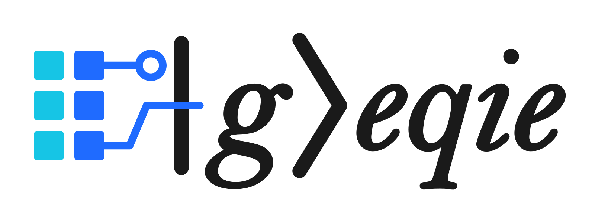
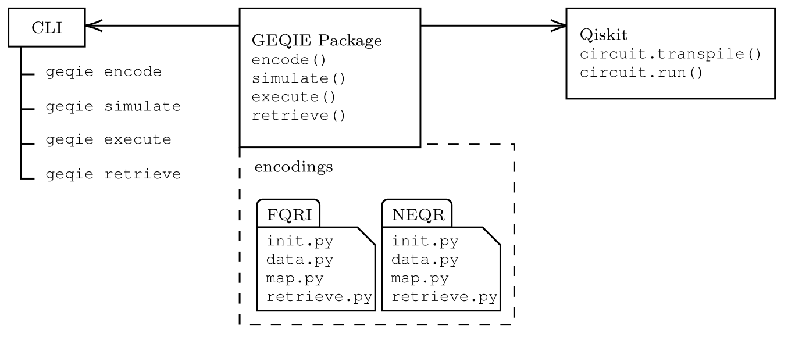
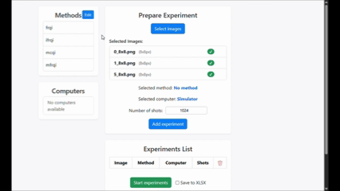

<!-- # GEQIE -->




## Description <!-- omit in toc -->

GEQIE (from General Equation of Quantum Image Encoding [[1](#references)]) is a framework for rapid prototyping, simulation, and evaluation of quantum image encodings. Each encoding is defined by a small set of functions (`init`, `data`, `map`, and optionally `retrieve`), from which GEQIE builds the encoding circuit. It can later run the circuit on a simulator or hardware backend, and reconstruct the image from the measurement results. 


## Table of contents <!-- omit in toc -->

- [Packages](#packages)
- [Installation](#installation)
- [Examples](#examples)
  - [Notebooks](#notebooks)
    - [GEQIE](#geqie)
    - [GEQIE QML](#geqie-qml)
  - [CLI usage](#cli-usage)
- [Playground (GUI)](#playground-gui)
- [Citation](#citation)
- [Related research](#related-research)
- [Acknowledgements](#acknowledgements)
- [References](#references)

Related documentation:
- [`geqie/README.md`](geqie/README.md)
- [`geqie-qml/README.md`](geqie-qml/README.md)
- [`gui/README.md`](gui/README.md)


The repository includes the core library with CLI, quantum machine learning (QML) extensions, and a web-based GUI playground.




## Packages

| Package | Description |
|---|---|
| [`geqie/`](geqie/README.md) | Core quantum image encoding library with CLI |
| [`geqie-qml/`](geqie-qml/README.md) | QML integration extensions for geqie |


## Installation

```bash
pip install geqie/
pip install geqie-qml/   # optional, for QML support
```


## Examples

### Notebooks

See the [`examples/`](examples/) directory for iPython notebooks:


#### GEQIE

| Notebook | Description |
|---|---|
| [`cosmic_web/geqie_mfrqi_encoding.ipynb`](experiments/cosmic_web/geqie_mfrqi_encoding.ipynb) | MFRQI encoding of Cosmic Web |
| [`encodings/`](examples/encodings) | Encoding examples notebooks directory, e.g. FRQI below |
| [`encodings/frqi.ipynb`](examples/encodings/frqi.ipynb) | FRQI encoding |
| [`execute.ipynb`](examples/execute.ipynb) | Execution on IBM Quantum Platform with the `execute` command |
| [`experiments_cli.ipynb`](examples/experiments_cli.ipynb) | CLI-based experiment workflows |


#### GEQIE QML

| Notebook | Description |
|---|---|
| [`geqie_qml_precompute.ipynb`](examples/geqie_qml_precompute.ipynb) | QML precomputation pipeline |
| [`geqie_qml_training_precomputed.ipynb`](examples/geqie_qml_training_precomputed.ipynb) | QML training on precomputed data |
| [`geqie_qml_training_live.ipynb`](examples/geqie_qml_training_live.ipynb) | QML training on live images |


### CLI usage

See [geqie/README.md](geqie/README.md) for full CLI reference.


## Playground (GUI)

Public GUI access: [https://web-staging-eb84.up.railway.app](https://web-staging-eb84.up.railway.app/) (Pending deployment on the university infrastructure).



See the [gui/README.md](gui/README.md) for instructions on running the GEQIE GUI locally.


## Citation

If you use this code in your research, please cite the main paper:

*GEQIE Framework for Rapid Quantum Image Encoding* at https://arxiv.org/abs/2512.24973


## Related research

- [Main paper - GEQIE Framework for Rapid Quantum Image Encoding](https://arxiv.org/abs/2512.24973)
- [ICCS 2024 Poster](https://www.researchgate.net/publication/383184874_General_Quantum_Image_Representation_Model_and_Framework)

## Acknowledgements

The authors would like to acknowledge that this repository is maintained for the OptiQ project. This Project has received funding from the European Union’s Horizon Europe programme under the grant agreement No 101080374-OptiQ. Supplementarily, the Project is co-financed from the resources of the Polish Ministry of Science and Higher Education in a frame of programme International Co-financed Projects. Disclaimer Funded by the European Union. Views and opinions expressed are however those of the author(s) only and do not necessarily reflect those of the European Union or the European Research Executive Agency (REA–granting authority). Neither the European Union nor the granting authority can beheld responsible for them.

## References

- [1] *Deliverable D3.1 (scientific) Report on a potential of quantum computers for image recognition*, https://cordis.europa.eu/project/id/101080374/results
