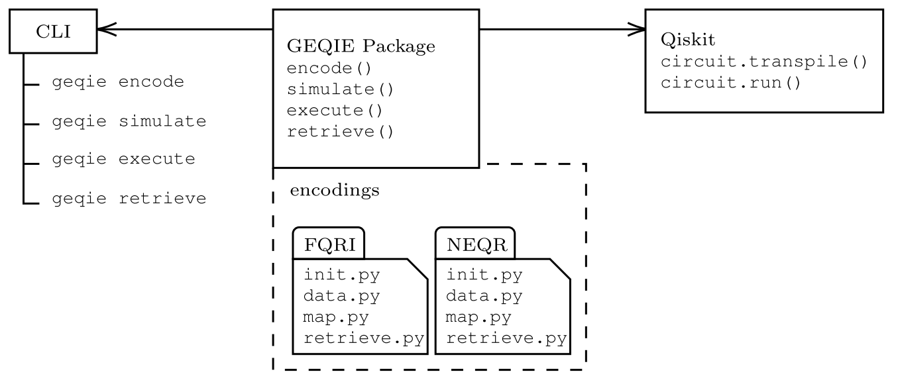

# GEQIE

{ width="50%" }

**GEQIE** (from *General Equation of Quantum Image Encoding*) is a framework for rapid prototyping, simulation, and evaluation of quantum image encodings.

Each encoding is defined by a small set of functions (`init`, `data`, `map`, and optionally `retrieve`), from which GEQIE builds the encoding circuit. It can then run the circuit on a simulator or hardware backend and reconstruct the image from the measurement results.

## Packages

| Package | Description |
|---|---|
| [`geqie`](api/geqie.md) | Core quantum image encoding library with CLI |
| [`geqie-qml`](user-guide/qml.md) | QML (PyTorch) integration extensions for `geqie` |

## Where to next

- [Getting started](getting-started.md) - install GEQIE and encode your first image.
- [Encodings](user-guide/encodings.md) - built-in encodings and how to write your own.
- [CLI](user-guide/cli.md) - encode and simulate images from the command line.
- [Examples](examples.md) - Jupyter notebooks.
- [API reference](api/geqie.md) - full Python API.

## Citation

If you use GEQIE in your research, please cite the main paper:

*GEQIE Framework for Rapid Quantum Image Encoding*, [arXiv:2512.24973](https://arxiv.org/abs/2512.24973).

### Related research

- [Main paper - GEQIE Framework for Rapid Quantum Image Encoding](https://arxiv.org/abs/2512.24973)
- [ICCS 2024 Poster](https://www.researchgate.net/publication/383184874_General_Quantum_Image_Representation_Model_and_Framework)
- *Deliverable D3.1 (scientific) Report on a potential of quantum computers for image recognition*, [CORDIS](https://cordis.europa.eu/project/id/101080374/results)

## Acknowledgements

The authors would like to acknowledge that this repository is maintained for the OptiQ project. This Project has received funding from the European Union’s Horizon Europe programme under the grant agreement No 101080374-OptiQ. Supplementarily, the Project is co-financed from the resources of the Polish Ministry of Science and Higher Education in a frame of programme International Co-financed Projects. Disclaimer Funded by the European Union. Views and opinions expressed are however those of the author(s) only and do not necessarily reflect those of the European Union or the European Research Executive Agency (REA–granting authority). Neither the European Union nor the granting authority can beheld responsible for them.
