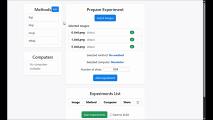

# Web GUI

The GEQIE web playground lets you encode, simulate, and compare encodings in the browser.

Public instance: [https://web-staging-eb84.up.railway.app](https://web-staging-eb84.up.railway.app/) (pending deployment on the university infrastructure).



## Running locally

The GUI is a Django application run with Docker Compose. From the repository root:

```bash
make build   # build the image
make up      # start the stack
make down    # stop the stack
```

The page is served at `http://localhost:8000` and the admin panel at `http://localhost:8000/admin`.

Alternatively, run Docker Compose directly from the `gui/` directory:

```bash
cd gui
docker compose build
docker compose up
docker compose exec web python gui/manage.py migrate --noinput
docker compose exec web python gui/manage.py createsuperuser
```
